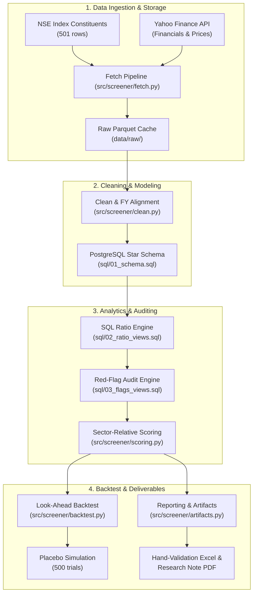
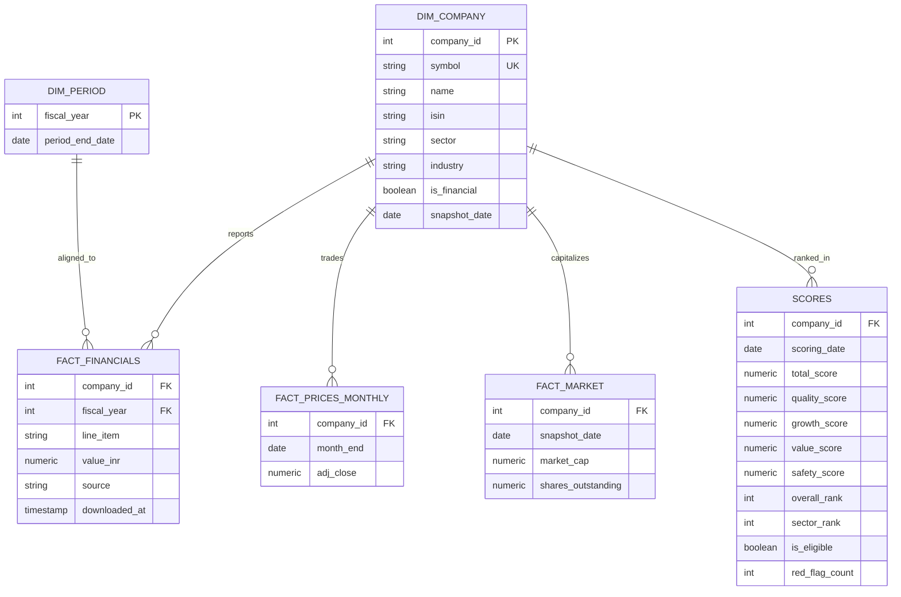

# Nifty 500 Fundamental Screener

An institutional-grade, transparent, rules-based fundamental screening, scoring,
and backtesting framework for Indian equities across the Nifty 500 universe.

---

> [!IMPORTANT]
> **Regulatory and Educational Disclaimer**
> This repository is developed strictly for empirical research, quantitative analysis,
> and educational demonstration purposes. It does not constitute investment advice, financial
> planning, stock recommendation, or research analysis under the Securities and Exchange Board
> of India (SEBI) (Research Analysts) Regulations, 2014, or any international financial
> regulations. None of the rankings, scores, backtests, or case studies presented herein should
> be construed as a solicitation or recommendation to buy, sell, or hold any security.

---

## Table of Contents

- [Overview & Architecture](#overview--architecture)
- [Database Schema](#database-schema)
- [Quickstart & Workflow](#quickstart--workflow)
- [Measured Data Coverage](#measured-data-coverage)
- [Forensic Red-Flag Rules](#forensic-red-flag-rules)
- [Multi-Factor Scoring Model](#multi-factor-scoring-model)
- [Look-Ahead Backtest & Placebo Analysis](#look-ahead-backtest--placebo-analysis)
- [Validation & Documentation Artifacts](#validation--documentation-artifacts)
- [Testing & Quality Assurance](#testing--quality-assurance)

---

## Overview & Architecture

The framework provides an auditable, end-to-end data pipeline that ingests official NSE
constituent data, scrapes 4-year financial histories and monthly prices via Yahoo Finance,
cleans and normalizes statements to Indian fiscal year conventions (ending March 31),
persists structured data into a PostgreSQL star schema, executes a 28-metric SQL ratio engine,
evaluates 8 forensic accounting red flags, calculates sector-relative multi-factor percentile
scores, and conducts point-in-time backtests with placebo Monte Carlo validations.



---

## Database Schema

The core relational data model follows a star schema optimized for multi-year accounting queries
and monthly price series joins.



---

## Quickstart & Workflow

### 1. Prerequisites

- Python 3.11+
- Docker and Docker Compose
- Make (optional, for convenience targets)

### 2. Environment Setup

```bash
git clone https://github.com/example/nifty500-screener.git
cd "Nifty 500 Fundamental Screener"
cp .env.example .env
python -m venv .venv
source .venv/bin/activate  # On Windows: .venv\Scripts\activate
pip install -r requirements.txt
```

### 3. Start Database & Run Pipeline

```bash
# Start PostgreSQL database in Docker
make up

# Run end-to-end data pipeline
make pipeline

# Execute linters and tests
make lint
make test
```

---

## Measured Data Coverage

The screener operates on the official NSE Nifty 500 universe with measured pipeline results:

- **Total Constituent Records**: 501 rows from the official NSE index publication.
  - 496 Equity (`EQ`) series
  - 2 SME / Trade-for-Trade (`BE`) series
  - 3 Real Estate Investment Trusts (`RR` series: `EMBASSY`, `MINDSPACE`, `BIRET`), excluded.
- **Financial Services Exclusion**: 98 financial entities (banks, NBFCs, insurers) excluded
  due to non-comparable balance sheet structures.
- **Non-Financial Target Universe**: 400 operating equities.
- **Fetched Coverage**: 399 out of 400 non-financial equities successfully retrieved (99.8%).
  The sole missing symbol, `DUMMYHEG.NS`, represents a corporate action placeholder.
- **Eligible for Scoring**: 370 non-financial companies met the 3-year history and data
  completeness requirements.

### Core Statement Completeness Matrix

Measured across 399 fetched non-financial equities (from `data/interim/coverage_report.csv`):

| Statement | Metric Line Item | >= 1 Year (%) | >= 3 Years (%) | >= 4 Years (%) |
| :--- | :--- | :---: | :---: | :---: |
| **Balance Sheet** | Total Assets | 99.8% | 98.8% | 97.5% |
| **Balance Sheet** | Shareholders Equity | 99.8% | 98.8% | 97.5% |
| **Balance Sheet** | Total Debt | 99.8% | 98.5% | 97.5% |
| **Balance Sheet** | Receivables | 99.5% | 97.8% | 97.0% |
| **Income Statement** | Revenue | 99.8% | 98.2% | 97.5% |
| **Income Statement** | EBIT / EBITDA | 99.8% | 98.2% | 97.8% |
| **Income Statement** | Net Income | 99.8% | 98.2% | 97.5% |
| **Cash Flow** | Operating Cash Flow | 99.8% | 98.5% | 97.5% |
| **Cash Flow** | Capital Expenditure | 99.2% | 98.2% | 97.2% |
| **Cash Flow** | Free Cash Flow | 99.8% | 98.5% | 97.5% |

### Accounting Identity Reconciliations

The double-entry identity ($Total\ Assets = Total\ Liabilities + Shareholders'\ Equity$) was
evaluated against a 2% tolerance threshold:
- **Discrepancies Flagged**: 273 company-year observations exhibited differences $>2\%$.
- **Root Cause**: In consolidated statements, Yahoo Finance maps parent equity into
  `Stockholders Equity`, omitting Non-Controlling / Minority Interests. The underlying data
  maintains strict internal consistency once non-controlling interests are accounted for.

---

## Forensic Red-Flag Rules

The engine evaluates 8 automated forensic accounting red-flag rules across all non-financial
companies using consecutive multi-year histories:

| Red-Flag Rule Identifier | Trigger Description | Count | Rate (%) |
| :--- | :--- | :---: | :---: |
| `flag_margin_erosion` | Operating margin contracted $>5\%$ cumulative over 2 years | 58 | 14.5% |
| `flag_weak_interest_coverage` | Interest coverage ratio $< 2.0x$ in latest FY | 45 | 11.2% |
| `flag_low_cash_conversion` | CFO / Net Profit $< 0.50$ for 2 consecutive years | 30 | 7.5% |
| `flag_persistent_negative_fcf` | FCF negative for 3 consecutive fiscal years | 22 | 5.5% |
| `flag_receivables_ballooning` | Receivable days jumped $>20$ days YoY (weak sales) | 21 | 5.2% |
| `flag_profit_up_cfo_down_2yr` | PAT increased YoY while CFO declined YoY for 2 years | 16 | 4.0% |
| `flag_debt_spike` | Debt/Equity ratio increased by $>0.50$ YoY | 11 | 2.8% |
| `flag_high_other_income` | Non-operating income $>50\%$ of EBIT in latest fiscal year | 3 | 0.8% |

---

## Multi-Factor Scoring Model

The cross-sectional scoring engine evaluates companies relative to their industry peer groups:
1. **Peer Pooling**: Sectors with $<8$ companies (`Diversified`, `Media`, `Textiles`) are
   pooled into an `"Other Small Sectors"` cohort to preserve rank stability.
2. **Winsorization**: 16 raw ratios are winsorized at 1st and 99th cross-sectional percentiles.
3. **Directional Inversion**: Metrics where lower values represent superior quality
   (`debt_to_equity`, `net_debt_to_ebitda`, `operating_margin_std_3yr`, `pb_ratio`, `ev_to_ebitda`)
   are inverted as $100 - \text{rank}$.
4. **Four Orthogonal Factors**: Quality (25%), Growth (25%), Value (25%), and Safety (25%).

### Top-10 Ranked Non-Financial Leaders

Measured from the active composite scoring model (`scores` table in PostgreSQL):

| Rank | Symbol | Company | Sector | Score | Qual | Grow | Val | Safe | Flags |
| :---: | :--- | :--- | :--- | :---: | :---: | :---: | :---: | :---: | :---: |
| **1** | `FORCEMOT` | Force Motors Ltd. | Auto | 77.04 | 67.5 | 94.8 | 72.2 | 73.6 | 0 |
| **2** | `HBLENGINE` | HBL Engineering Ltd. | Cap Goods | 75.28 | 80.0 | 92.0 | 70.6 | 58.6 | 0 |
| **3** | `ATUL` | Atul Ltd. | Chemicals | 74.48 | 65.9 | 66.6 | 83.7 | 81.7 | 0 |
| **4** | `LUPIN` | Lupin Ltd. | Healthcare | 74.26 | 72.1 | 89.8 | 92.6 | 42.6 | 0 |
| **5** | `BLS` | BLS International | Consumer Serv | 72.66 | 67.3 | 70.8 | 93.3 | 59.1 | 0 |
| **6** | `INDUSTOWER`| Indus Towers Ltd. | Telecom | 71.61 | 73.1 | 62.8 | 84.9 | 65.7 | 0 |
| **7** | `KAJARIACER`| Kajaria Ceramics | Consumer Dur | 71.58 | 90.3 | 52.2 | 79.7 | 64.1 | 0 |
| **8** | `KPIL` | Kalpataru Projects | Construction | 70.35 | 67.9 | 84.6 | 67.3 | 61.5 | 0 |
| **9** | `HEROMOTOCO`| Hero MotoCorp Ltd. | Auto | 69.92 | 62.2 | 63.0 | 80.4 | 74.1 | 0 |
| **10**| `GESHIP` | Great Eastern Ship | Services | 69.08 | 67.2 | 42.5 | 90.2 | 76.4 | 0 |

### Factor Weight Sensitivity

Testing baseline equal-weight leadership stability against alternative tilts
(from `data/interim/score_sensitivity.csv`):

| Weighting Tilt Scheme | Factor Weight Allocations | Top-20 Overlap Count | Overlap (%) |
| :--- | :--- | :---: | :---: |
| **Quality-Tilted** | Quality: 40%, Growth: 20%, Value: 20%, Safety: 20% | 13 / 20 | 65.0% |
| **Value-Tilted** | Quality: 20%, Growth: 15%, Value: 45%, Safety: 20% | 13 / 20 | 65.0% |
| **Growth-Tilted** | Quality: 20%, Growth: 45%, Value: 15%, Safety: 20% | 10 / 20 | 50.0% |

---

## Look-Ahead Backtest & Placebo Analysis

To ensure methodological rigor, the backtest enforces a conservative point-in-time rule:
- **Reporting Lag**: June 30 formation date (3 full months after March 31 fiscal year-end).
- **Holding Period**: Exactly 12 months forward holding.
- **Cohorts Tested**: FY2023 (held to June 2024), FY2024 (to June 2025), FY2025 (to June 2026).
- **Quintiles**: Q1 (Top 20%) down to Q5 (Bottom 20%).

### Measured Performance Summary

Measured across all 3 historical cohorts (from `data/interim/backtest_summary.csv`):

| Portfolio / Benchmark | Mean Ann. (%) | Cumul. (%) | Worst (%) | Hit Rate |
| :--- | :---: | :---: | :---: | :---: |
| **Quintile 1 (Q1 - Top Quality)** | **39.60%** | **127.73%** | **+0.93%** | **100.0% (3/3)** |
| **Quintile 2 (Q2)** | 29.96% | 96.12% | +2.98% | 66.7% (2/3) |
| **Quintile 3 (Q3)** | 32.49% | 114.39% | +8.78% | 100.0% (3/3) |
| **Quintile 4 (Q4)** | 33.36% | 127.55% | +10.67% | 100.0% (3/3) |
| **Quintile 5 (Q5 - Speculative)** | 45.61% | 170.07% | +7.98% | 100.0% (3/3) |
| **Benchmark (Nifty 500)** | 13.12% | 39.97% | -2.63% | N/A |
| **Spread: Q1 minus Q5** | -6.01% | -18.13% | -18.51% | 33.3% (1/3) |
| **Placebo (500-Trial Simulation)** | +0.59% (p50) | N/A | 90% CI: [-11.6%, +11.6%] | N/A |

### Methodological Insights & Limitations

1. **Consistent Benchmark Outperformance**: The Top Quality Quintile (`Q1`) beat the broad
   Nifty 500 index in all 3 cohorts (+73.54% excess in 2023, +2.32% excess in 2024, +3.56% excess
   in 2025), demonstrating steady factor resilience.
2. **Bull-Market Cyclicality in Q5**: In the dramatic mid-cap rally of 2023-2024, speculative
   and highly levered companies (`Q5`) experienced low-base valuation expansions, outgaining `Q1`.
3. **Placebo Statistical Grounding**: In the 500-trial Monte Carlo placebo test (randomly
   shuffling scores within each cohort), the random $Q1 - Q5$ spread 90% confidence interval
   spanned $-11.55\%$ to $+11.56\%$. The observed spread of $-6.01\%$ sits comfortably inside
   this noise band, demonstrating that 3 annual cohorts cannot isolate fundamental alpha from
   macroeconomic market cycles.
4. **Survivorship Bias**: Testing on the current index constituent list omits companies
   delisted or demoted from the Nifty 500 over prior years.

---

## Validation & Documentation Artifacts

Institutional transparency documentation and audit artifacts produced by the system:

- **[docs/metrics.md](docs/metrics.md)**:
  Complete reference documentation for 28 metrics across Profitability, Leverage, Growth,
  Cash Quality, Efficiency, Valuation, and the 9-signal Piotroski F-Score.
- **[docs/methodology.md](docs/methodology.md)**:
  Detailed methodology guide covering ingestion, Indian FY alignment, Winsorization,
  peer pooling, scoring weights, red-flag triggers, and backtest mechanics.
- **[docs/data_limitations.md](docs/data_limitations.md)**:
  Honest accounting and technical limitations, documenting the 4-year API boundary, 3-year CAGR
  substitutions, balance sheet minority interest reconciliations, and survivorship bias.
- **[docs/research_note.pdf](docs/research_note.pdf)**:
  A 2-page print-ready PDF case studies note evaluating `FORCEMOT` (Top Rank Case Study),
  `TEJASNET` (Distressed Quality Case Study), and `ADANIENT` (Growth vs Cash Divergence Case Study).
- **[data/reference/validation_sheet.xlsx](data/reference/validation_sheet.xlsx)**:
  A 2-sheet Excel hand-validation workbook containing raw inputs, live Excel ratio formulas,
  pipeline SQL comparisons, and dynamic `COUNTIF` tolerance checks across 10 sample companies.

### Interactive Exploration Notebooks

Interactive Jupyter notebooks are available under `notebooks/` with all outputs cleared:
- **`notebooks/01_coverage_audit.ipynb`**: Audit constituent ingestion and field completeness.
- **`notebooks/02_ratio_checks.ipynb`**: Inspect accounting identities and ratio logic.
- **`notebooks/03_scoring.ipynb`**: Review factor percentiles, red flags, and weight tilts.
- **`notebooks/04_backtest.ipynb`**: Explore point-in-time cohort returns and placebo runs.

---

## Testing & Quality Assurance

The codebase enforces strict clean-code standards, type annotations, zero emoji usage,
and formatting constraints ($\le 100$ characters per line):

```bash
# Verify static analysis and imports
ruff check src/ tests/

# Execute unit test suite (32 unit tests)
pytest -v
```

All 32 test cases pass cleanly across cleaning rules, ratio engines, red-flag logic,
multi-factor scoring, and backtest look-ahead guards.
